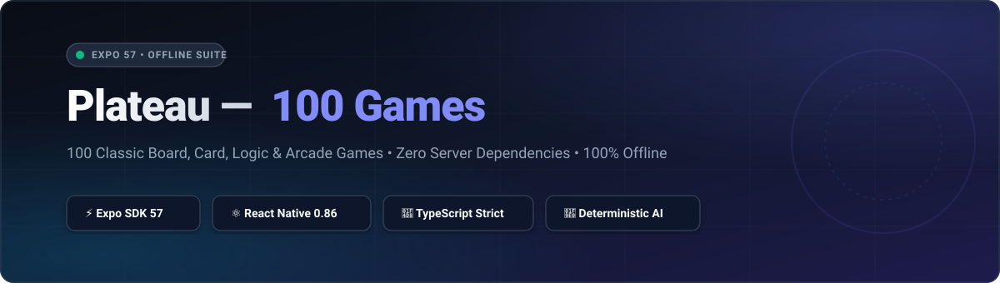
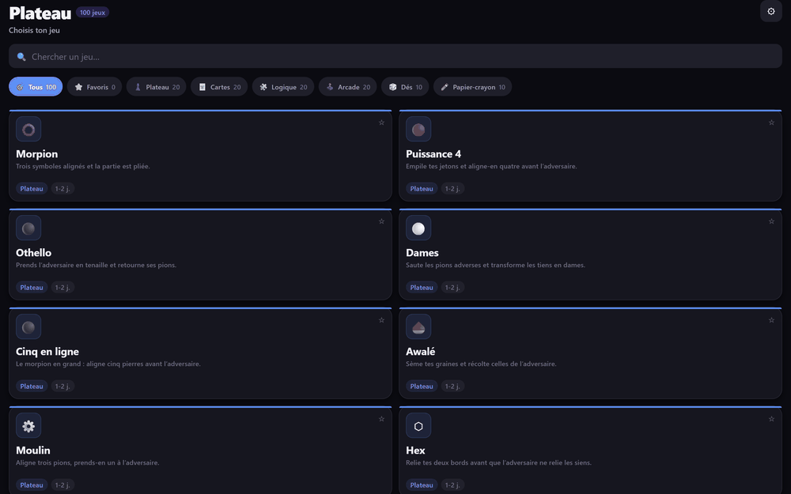
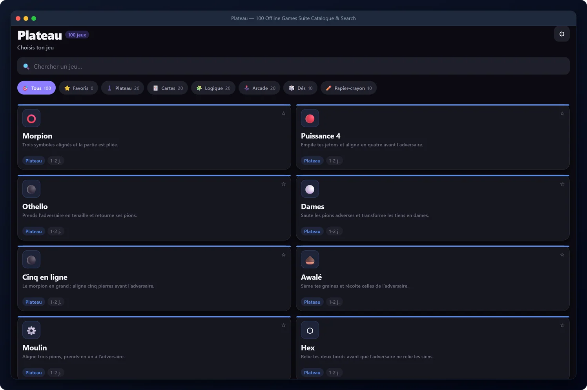
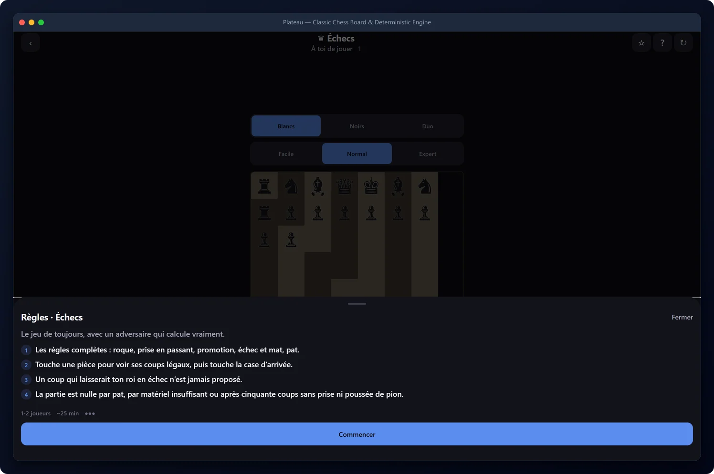
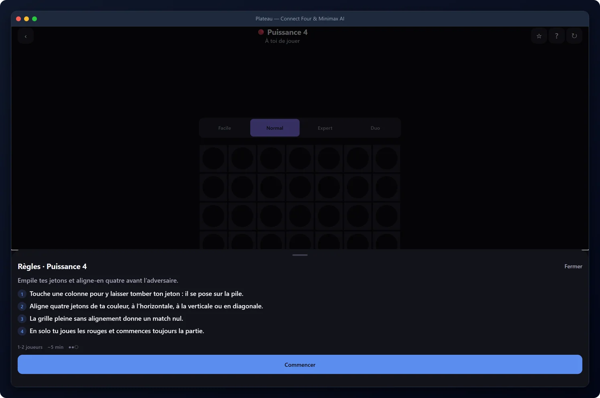
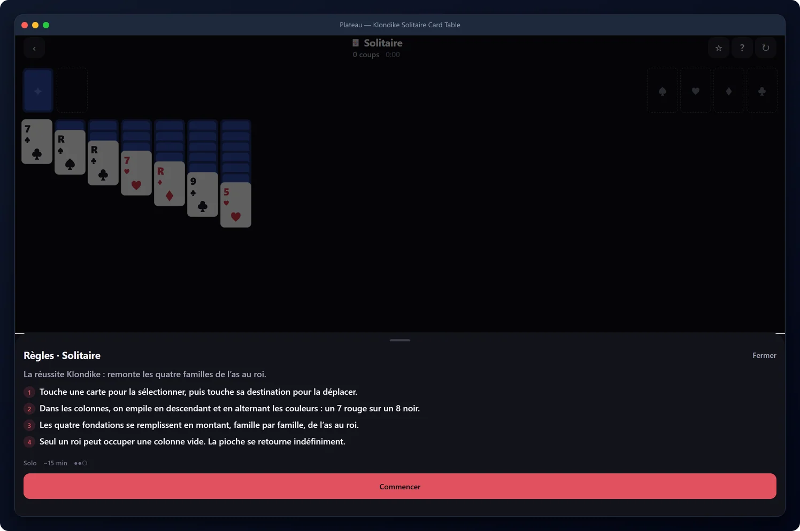
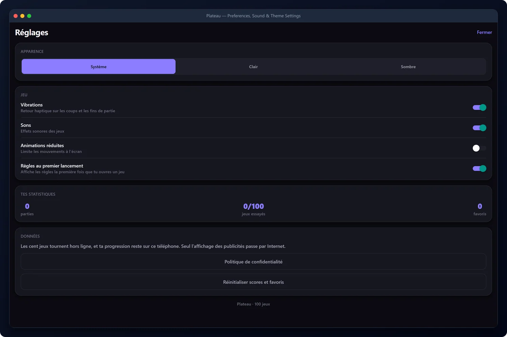
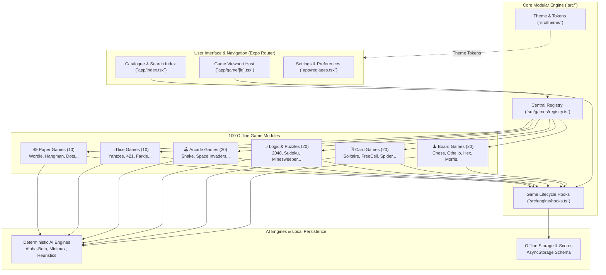

<div align="center">



# Plateau — 100 Offline Games Suite

[](https://expo.dev)
[](https://reactnative.dev)
[](https://www.typescriptlang.org)
[](docs/ANNEXE.md)
[](LICENSE)

**A complete mobile and web gaming suite built with React Native and Expo: 100 classic board, card, logic, arcade, dice, and paper-and-pencil games unified into a single responsive catalogue with zero server dependencies.**

[Overview](#overview) • [Live Demo](#live-demo) • [Screenshots](#screenshots) • [Highlights](#highlights--features) • [Architecture](#architecture) • [Install & Configure](#how-to-install--configure) • [How to Use](#how-to-use) • [Create & Customize](#how-to-create--customize) • [Verification](#quality-assurance--verification) • [License](#license)

</div>

---

## Overview

All 100 games function **100% offline**: no user accounts, no backend tracking, and no external API reliance. High scores, personal records, preferences, and favorites are persisted locally on the user's device.

Whether playing solo against deterministic AI heuristics or with a friend in pass-and-play local multiplayer, Plateau delivers smooth 60 FPS interactions across web browsers, tablets, and native iOS / Android mobile environments.

---

## Live Demo

<div align="center">



*Fluid transitions across the game catalogue, deterministic chess engine, connect four minimax AI, solitaire, and preferences.*

</div>

---

## Screenshots

<table width="100%">
  <tr>
    <td width="50%" align="center">
      <b>Catalogue &amp; Game Search</b><br/><br/>
      
    </td>
    <td width="50%" align="center">
      <b>Classic Chess &amp; FIDE Engine</b><br/><br/>
      
    </td>
  </tr>
  <tr>
    <td width="50%" align="center">
      <b>Connect Four &amp; Minimax AI</b><br/><br/>
      
    </td>
    <td width="50%" align="center">
      <b>Klondike Solitaire Card Game</b><br/><br/>
      
    </td>
  </tr>
  <tr>
    <td colspan="2" align="center">
      <b>Application Settings &amp; Audio Preferences</b><br/><br/>
      
    </td>
  </tr>
</table>

---

## Highlights & Features

- **100 Playable Games Across 6 Categories:**
  - ♟️ **20 Board Games:** Chess, Backgammon, Othello, Checkers, Nine Men's Morris, Hex, Quarto, Game of the Amazons, Brandubh, Ludo...
  - 🃏 **20 Card Games:** Klondike Solitaire, FreeCell, Spider, Yukon, Canfield, Pyramid, Scopa, President, Rummy, 31, Forty Thieves...
  - 🧩 **20 Logic & Puzzles:** 2048, Minesweeper, Sudoku, Nonogram, Sokoban, Binairo, Futoshiki, Hitori, Mahjong Solitaire, Traffic Jam...
  - 🕹️ **20 Arcade Games:** Snake, Brick Breaker, Space Invaders, Asteroids, Ghost Maze, Bubble Shooter, Missile Command, Frogger...
  - 🎲 **10 Dice Games:** Yahtzee (Yams), Farkle, 421, Liar's Dice, Craps, Zanzibar, Chicago, Pig, Shut the Box...
  - ✏️ **10 Paper & Pencil Games:** Hangman, Wordle (Motus), Battleship, Boggle, Word Search, Dots and Boxes, SOS, Anagrams...
- **Deterministic AI Opponents:** Alpha-beta pruning for Checkers and Connect Four, positional evaluation matrices for Othello, full minimax for Tic-Tac-Toe, Monte-Carlo tree search for Hex, and FIDE-compliant move generation for Chess.
- **Pass-and-Play Duo Mode:** Local 2-player multiplayer on a single device for compatible board and card games.
- **Adaptive Theme:** Seamless light and dark mode support with tailored high-contrast game surfaces.
- **Zero Network Requirement:** Fully playable offline in airplane mode or disconnected environments.

---

## Architecture



---

## How to Install & Configure

### Prerequisites

- [Node.js](https://nodejs.org/) (v18 or higher recommended; v20+ supported)
- [npm](https://www.npmjs.com/) or [yarn](https://yarnpkg.com/)
- [Expo CLI](https://docs.expo.dev/more/expo-cli/) (installed automatically via `npx expo`)

### Installation

1. **Clone the repository:**
   ```bash
   git clone https://github.com/Emincanozen/plateau-100-games.git
   cd plateau-100-games
   ```

2. **Install project dependencies:**
   ```bash
   npm install
   ```

3. **Configure Environment Variables (Optional):**
   Copy the example environment configuration if you plan to enable AdMob in native production builds:
   ```bash
   cp .env.example .env
   ```
   *Note: For local web development and standard testing, no environment variables or keys are required.*

---

## How to Use

### Running in the Browser (Fastest Developer Workflow)

Run the Expo web interface directly in your browser:
```bash
npm run web
```
The application will launch at `http://localhost:8081` (or your configured port). You can search games, filter by category, and play any game directly.

### Running on Mobile Emulators & Devices

Start the unified Expo development server:
```bash
npm start
```
From the interactive terminal prompt:
- Press `a` to open in the **Android Emulator** (requires Android Studio & Android SDK).
- Press `i` to open in the **iOS Simulator** (macOS with Xcode required).
- Scan the displayed QR code with the Expo Go app or your custom development client build.

### Building Standalone Native Binaries

Build production or preview packages using EAS Build:
```bash
# Preview standalone APK for Android
npx eas-cli build --platform android --profile apercu

# Production App Bundle (AAB) & iOS IPA
npx eas-cli build --platform all --profile production
```

---

## How to Create / Customize

Plateau was engineered around a modular game engine architecture. Adding new games or customizing existing logic is straightforward.

### 1. Creating a New Game

Every game is an isolated module conforming to the `GameModule` interface.

1. **Create the game component in the relevant category folder:**
   Example: `src/games/plateau/my-new-game.tsx`

   ```tsx
   import React, { useState } from 'react';
   import { View, StyleSheet, TouchableOpacity } from 'react-native';
   import type { GameMeta, GameScreenProps } from '@/engine/types';
   import { useFrameRestart, useFrameStatus } from '@/engine/hooks';
   import { Txt } from '@/ui/Txt';

   export const meta: GameMeta = {
     id: 'my-new-game',
     name: 'My New Game',
     category: 'plateau', // 'plateau' | 'cartes' | 'logique' | 'arcade' | 'des' | 'papier'
     shortDesc: 'A fast-paced board game created for Plateau.',
     rules: 'Tap adjacent tiles to control the board. Clear all opponent pieces to win.',
     minPlayers: 1,
     maxPlayers: 2,
     hasAi: true,
     difficulty: ['facile', 'moyen', 'difficile'],
   };

   export default function MyNewGame({ submitScore, best, haptic }: GameScreenProps) {
     const [score, setScore] = useState(0);

     const handleRestart = () => {
       setScore(0);
       haptic('light');
     };

     // Connect to top navigation bar buttons
     useFrameRestart(handleRestart);
     useFrameStatus(<Txt style={styles.status}>Score: {score} | Best: {best ?? 0}</Txt>);

     return (
       <View style={styles.container}>
         <TouchableOpacity
           style={styles.button}
           onPress={() => {
             const next = score + 10;
             setScore(next);
             submitScore(next);
             haptic('impactMedium');
           }}
         >
           <Txt style={styles.buttonText}>Tap to Score</Txt>
         </TouchableOpacity>
       </View>
     );
   }

   const styles = StyleSheet.create({
     container: { flex: 1, alignItems: 'center', justifyContent: 'center' },
     status: { fontSize: 16, fontWeight: '600' },
     button: { padding: 16, backgroundColor: '#4F46E5', borderRadius: 12 },
     buttonText: { color: '#FFFFFF', fontWeight: 'bold' },
   });
   ```

2. **Register the game in the central registry:**
   Open `src/games/registry.ts`:
   ```typescript
   import * as myNewGame from './plateau/my-new-game';

   export const ALL_GAMES: GameEntry[] = [
     // ...
     registerGame(myNewGame),
   ];
   ```

3. **That's it!** The game will automatically appear in the catalogue, search index, favorites list, category view, and receive automatic state and score persistence.

### 2. Customizing Themes & Design Tokens

Design tokens are located in `src/theme/`:
- `colors.ts`: Palettes for dark and light modes, category accent colors, and game board textures.
- `typography.ts`: Scaled font families and sizes.
- `spacing.ts`: Margin, padding, and layout grid dimensions.

### 3. Modifying AI Difficulty & Game Engines

Shared algorithms and utility engines are in `src/games/lib/`:
- `cards.ts`: Standard 52-card and tarot decks, shuffling algorithms, and card deal animations.
- `dice.ts`: Standard and custom dice rolls, combination evaluators.
- `minimax.ts`: Generic alpha-beta minimax solver for 2-player zero-sum turn-based games.
- `words.ts`: Scrabble and Motus dictionary word banks.

---

## Quality Assurance & Verification

The repository contains an automated verification test suite:

```bash
npm run verifier
```

This executes nine automated validation passes:
- **Typecheck:** `npm run typecheck` — Full TypeScript compiler check under strict settings.
- **Storage Integrity:** `npm run test:stockage` — Local storage schema normalization and corruption recovery.
- **Static Audit:** `npm run audit` — Game hooks compliance across all 100 modules.
- **Privacy Audit:** `npm run audit:confidentialite` — Zero untrusted outbound network requests.
- **Rules Verification:** `npm run test:regles` & `npm run test:regles-jeux` — Deterministic game rule checks.
- **Engine Invariants:** `npm run test:moteurs` — FIDE chess move legality perft tests.

---

## License

This project is licensed under the [MIT License](LICENSE).
